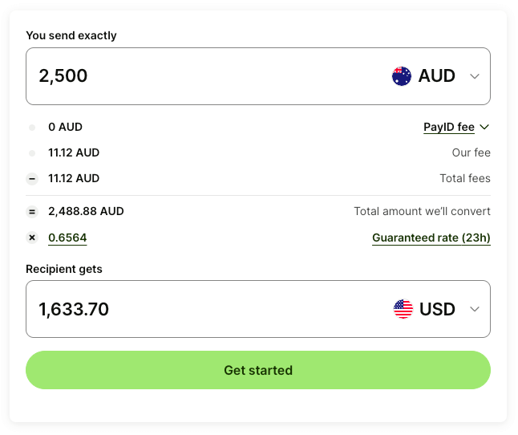
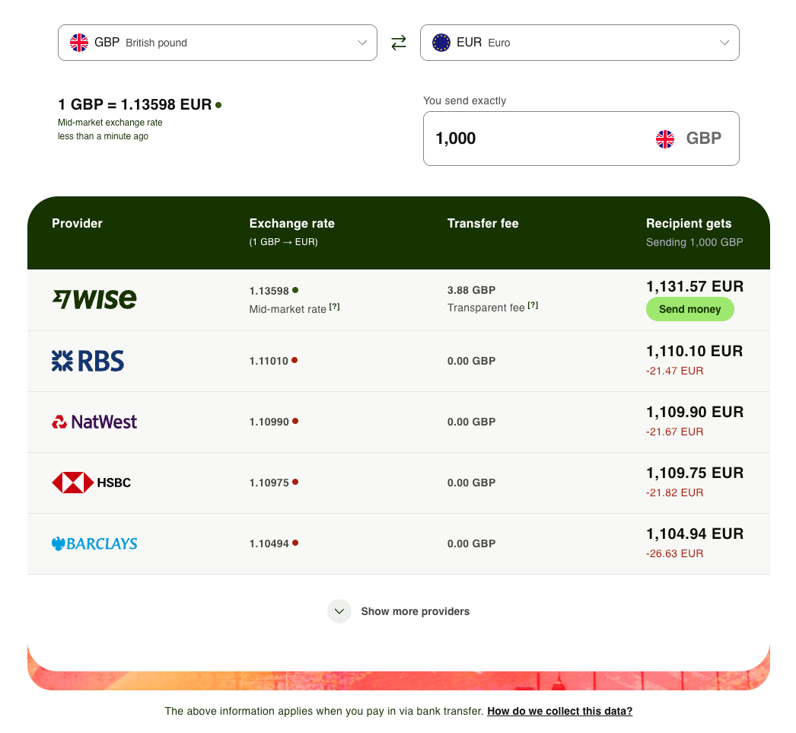
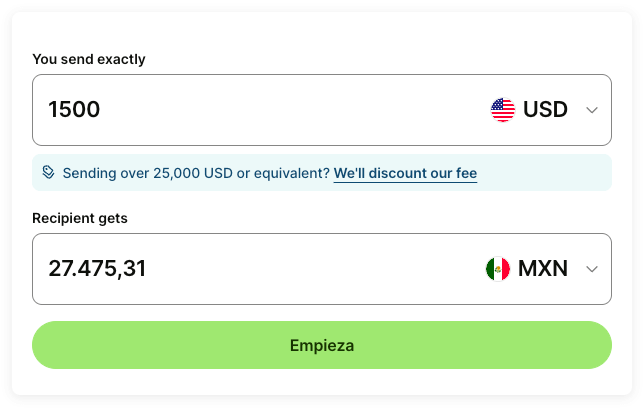
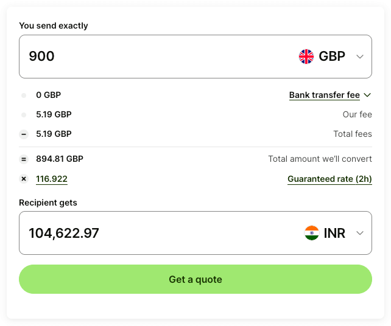
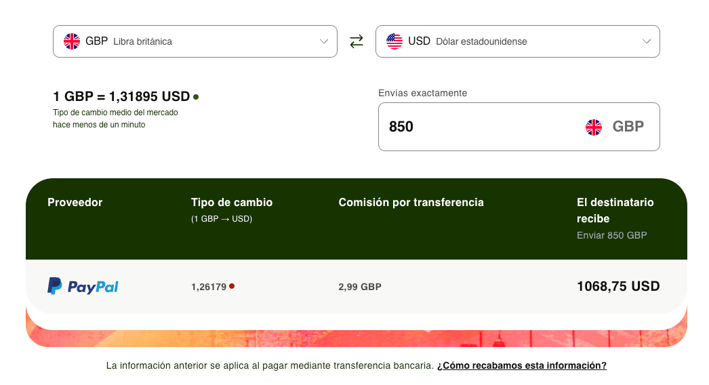
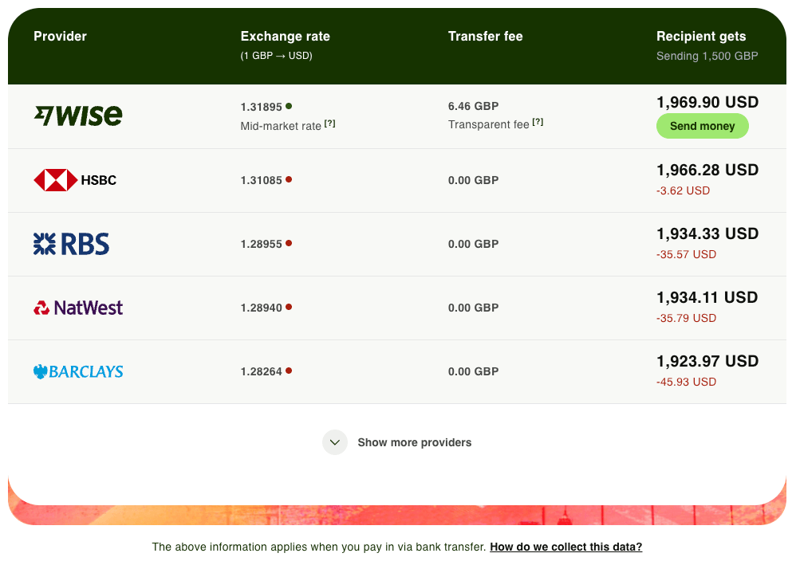

# Wise Public Widgets

**Quick Start**: New to web development? Jump to our [Step-by-Step Guide](#quick-start-guide) below.

The Wise public widgets provide an easy way to embed rich, interactive content onto your website. These widgets help your visitors compare money transfer options and calculate exchange rates, while you can earn commission through the [Wise affiliate program](https://wise.com/gb/affiliate-program/).

## What You Can Embed

There are two widgets available:

### 📊 Calculator Widget
Interactive currency exchange calculator showing real-time rates and transfer quotes.



**Perfect for**: Currency conversion tools, travel blogs, expat websites

### 📋 Comparison Widget
Money transfer comparison table showing multiple providers and their fees.



**Perfect for**: Financial advice sites, money transfer guides, comparison pages

---

## Quick Start Guide

**Prerequisites**: Basic HTML knowledge and access to edit your website's code.

### Choose Your Widget:
- **Want a calculator?** → [Calculator Setup](#adding-the-calculator-widget-to-your-site)
- **Want a comparison table?** → [Comparison Setup](#adding-the-comparison-widget-to-your-site)
- **Not sure?** → Try the calculator first (it's easier to implement)

### Testing Your Implementation:
1. After adding the code, refresh your webpage
2. The widget should load within a few seconds
3. Try interacting with it to ensure it works properly
4. **Having issues?** Check our [Troubleshooting](#troubleshooting) section below

---

## Adding the Calculator Widget to Your Site

The calculator widget requires two pieces of code: an HTML container and a JavaScript snippet. Don't worry - you can copy and paste both!

### Step 1: Add the HTML Container

First, place this HTML code where you want the calculator to appear on your page:

```html
<div id="wise-calc-widget">
    <!-- The calculator will appear here automatically -->
</div>
```

### Step 2: Add the JavaScript Code

Next, add this JavaScript code **just before the closing `</body>` tag** in your HTML page:
```html
<script type="text/javascript">
(function() {
  window.onload = function() {
    /* Change the variables below */
    var sourceCurrencyCode = "AUD";
    var targetCurrencyCode = "USD";
    var sourceAmount = 2500;
    var callToActionLabel = "Get started";
    var hideCta = false;
    var hideDetails = false;
    var affiliateLink = "YOUR_TRACKING_LINK";
    var lang = "en";
    var width = "580px";
    var height = "470px";
    /* Do not modify the code below */
    var redirectUrlParams = encodeURIComponent("https://wise.com/");
    var redirectUrl = encodeURIComponent(affiliateLink + "?u=" + redirectUrlParams);
    var wiseIframeUrl =
      "https://wise.com/widget/calculator?sourceCurrencyCode=" + sourceCurrencyCode + "&targetCurrencyCode=" + targetCurrencyCode + "&amount=" + sourceAmount + "&cta=" + callToActionLabel + "&hideCta=" + hideCta + "&hideDetails=" + hideDetails + "&redirectUrl=" + redirectUrl + "&lang=" + lang + "&theme=light"
    var wiseIframe = document.createElement('iframe');wiseIframe.frameBorder = 0;wiseIframe.width = width;wiseIframe.height = height;wiseIframe.id = "wise-calc";wiseIframe.scrolling = "no";wiseIframe.setAttribute("allowtransparency", "true");wiseIframe.setAttribute("src", wiseIframeUrl);
    document.getElementById("wise-calc-widget").appendChild(wiseIframe);
  };
})();
</script>
```

### Step 3: Customize Your Calculator (Optional)

The calculator works with default settings, but you can customize it by changing the variables at the top of the JavaScript code. Here's what each setting does:

| Variable           | Description                                     | Example                                     |
|--------------------|-------------------------------------------------|---------------------------------------------|
| `sourceCurrencyCode` | Set the source currency                         | `"EUR"`, `"GBP"`, `"USD"`, `"INR"`, etc                     |
| `targetCurrencyCode` | Set the target currency                         | `"EUR"`, `"GBP"`, `"USD"`, `"INR"`, etc                     |
| `sourceAmount`       | Set the initial value of money to be converted  | `1000`                                        |
| `callToActionLabel`  | Set the value of the CTA button                 | `"Get started"`                                 |
| `hideCta`            | Set to true to hide the call to action button   | `true` or `false`                               |
| `hideDetails`        | Set to true to hide the rate, savings, etc      | `true` or `false`                               |
| `affiliateLink`      | Your [affiliate link](https://wise.com/gb/affiliate-program/)                             | `"https://wise.prf.hn/click/camref:11001XXXX"` |
| `lang`               | Sets the language of the text in the calculator | `"en"`, `"pt"`, `"es"`, `"fr"`, `"de"`, `"ru"`                      |
| `width`              | Sets the width of the calculator widget         | `"580px"`                                       |
| `height`             | Sets the height of the calculator widget        | `"470px"`                                       |

Note the default `width` and `height` settings (580px wide x 470px high) assume you have `hideDetails` set to false (showing full details). If `hideDetails` is set to true, you can reduce the `height` of the widget container (we recommend 580px wide x 340px high for hidden details).

### Examples

USD to MXN in Spanish with custom CTA button and hidden details:
```javascript
/* Change the variables below */
var sourceCurrencyCode = "USD";
var targetCurrencyCode = "MXN";
var sourceAmount = 1500;
var callToActionLabel = "Empieza";
var hideCta = false;
var hideDetails = true;
var affiliateLink = "https://wise.prf.hn/click/camref:11001XXXX";
var lang = "es";
var width = "580px";
var height = "340px";
/* Do not modify the code below */
```



GBP to INR in English with custom CTA button and full quote breakdown:
```javascript
/* Change the variables below */
var sourceCurrencyCode = "GBP";
var targetCurrencyCode = "INR";
var sourceAmount = 900;
var callToActionLabel = "Get a quote";
var hideCta = false;
var hideDetails = false;
var affiliateLink = "https://wise.prf.hn/click/camref:11001XXXX";
var lang = "en";
var width = "580px";
var height = "470px";
/* Do not modify the code below */
```



## Adding the comparison widget to your site

### 1. Add and configure the HTML tag

Place the following code onto your page where you want the comparison widget to appear. Note that the link will be replaced when the table loads.
```html
<a class="tw-comparison"
  href="https://wise.com/gb/compare/?sendAmount=1000&sourceCurrency=GBP&targetCurrency=EUR"
  data-lang="en"
>The true cost of sending GBP to EUR</a>
```

The HTML above must be configured depending on which version of the widget you'd like to use. The `class` attribute on the first line should be set to one of the following two options:

- **Comparison complete widget**: For a full comparison table with selectors for route and amount, set the class to `tw-comparison` (note this is the default in the code above).
- **Comparison table only**: For a static comparison table that is fixed to a particular route and amount, set the class to `tw-comparison-table`.

Next, set the source currency, target currency, and amount by editing the `href` attribute. For example, to compare prices for sending 850 GBP to USD in a static comparison table, you'd configure the HTML as follows:
```html
<a class="tw-comparison-table"
  href="https://wise.com/gb/compare/?sendAmount=850&sourceCurrency=GBP&targetCurrency=USD"
>The true cost of sending GBP to USD</a>
```

### 2. Set any optional parameters

You can configure the table to behave differently using the following optional parameters. They are set as data attributes on the `<a>` element.

- `data-lang`: `string` ISO 639-1. Sets the language of the comparison table. Default is `en`.
- `data-source-country`: `string`  ISO 3166-1 alpha-3. Filters results by source country. i.e the origin country from where a user may want to send money from.
- `data-provider-country`: `string` ISO 3166-1 alpha-2. Filters by provider country. i.e the country which the provider belongs to (e.g Natwest - GB, ANZ - AU). This property is also useful for only showing national banks, rather than "global" providers (like Western Union, Moneygram, etc).
- `data-max-visible-providers`: `number` by default shows 3 providers and the rest are hidden under 'Show more providers' link.
- `data-expand-disclaimer`: `boolean`. Setting to true will render the table with the disclaimer already opened and scrolls the element into the visible area of the browser window.
- `data-affiliate-link`: `string` Your [affiliate tracking link](https://wise.com/gb/affiliate-program/). This will determine where users are sent when they click the Send Money CTA.

Examples of possible configurations are provided at the end of this guide.

### 3. Add the comparison table script tag

Add the following JavaScript code to your page immediately before the closing `</body>` tag:
```html
<script type="text/javascript">
(function() {
  window.onload = (function(d, s, id) {
    var js, fjs = d.getElementsByTagName(s)[0];
    if (d.getElementById(id)) return;
    js = d.createElement(s); js.id = id;
    js.src = "https://widgets.wise.com/widgets.js";
    fjs.parentNode.insertBefore(js, fjs);
  }(document, "script", "transferwise-wjs"));
})();
</script>
```

### Examples

To render a full comparison table in Spanish, showing quotes for sending 850 GBP to USD, limiting the quotes to 4 specific providers, and using your own personal affiliate link in the CTA, you'd use the following HTML:
```html
<a class="tw-comparison"
  href="https://wise.com/gb/compare/?sendAmount=850&sourceCurrency=GBP&targetCurrency=USD"
  data-lang="es"
  data-providers="transferwise,paypal,starling-bank,xoom,western-union"
  data-affiliate-link="https://wise.prf.hn/click/camref:11001XXXX"
>El verdadero costo de enviar GBP a USD</a>
```



To render a static comparison table in English, showing quotes for sending 1500 GBP to USD, you'd configure the HTML as follows:
```html
<a class="tw-comparison-table"
  href="https://wise.com/gb/compare/?sendAmount=1500&sourceCurrency=GBP&targetCurrency=USD"
  data-lang="en"
>The true cost of sending GBP to USD</a>
```



### Known limitations
- It's currently only possible to render a single comparison widget per page.

---

## Troubleshooting

### Widget Not Loading?
1. **Check your internet connection** - Widgets load from Wise's servers
2. **Verify your HTML structure** - Make sure the container div has the correct ID
3. **Check JavaScript placement** - The script should be before the closing `</body>` tag
4. **Look for JavaScript errors** - Open browser developer tools (F12) and check the Console tab

### Calculator Shows Blank Space?
- **Check currency codes** - Use 3-letter currency codes (USD, EUR, GBP, etc.)
- **Verify affiliate link format** - Make sure your affiliate link is valid
- **Check widget dimensions** - Ensure width/height values include "px"

### Comparison Table Not Appearing?
- **Verify the class name** - Use `tw-comparison` or `tw-comparison-table`
- **Check the href URL** - Ensure the comparison URL is properly formatted
- **Wait for loading** - Comparison tables can take 3-5 seconds to load

### Comparison Widget Has Double Borders?
- **Remove extra containers** - Don't wrap the `<a>` tag in divs with borders or shadows
- **Avoid conflicting CSS** - The widget has its own styling; extra containers can create double borders
- **Use minimal HTML** - Just use the `<a>` tag as shown in the examples above

### Still Having Issues?
1. Compare your code with the examples in this guide
2. Check that you haven't modified the "Do not modify" sections

---

## Advanced Configuration

### Multiple Calculators on One Page
To add multiple calculator widgets, change the container ID and iframe ID for each widget:

```html
<!-- First calculator -->
<div id="wise-calc-widget-1"></div>

<!-- Second calculator -->
<div id="wise-calc-widget-2"></div>
```

Then modify the JavaScript to target different containers:
```javascript
document.getElementById("wise-calc-widget-1").appendChild(wiseIframe);
// and for the second:
document.getElementById("wise-calc-widget-2").appendChild(wiseIframe2);
```

### Responsive Design
The widgets work on mobile devices, but you may want to adjust dimensions:

```javascript
// Mobile-friendly dimensions
var width = "100%";    // Full width
var height = "400px";  // Shorter height for mobile
```

---

## Need More Help?

- **Wise Affiliate Program**: [Learn about earning commissions](https://wise.com/gb/affiliate-program/)
- **Widget Support**: Contact the Wise affiliate team for technical assistance
- **Currency Codes**: [ISO 4217 currency code list](https://en.wikipedia.org/wiki/ISO_4217#List_of_ISO_4217_currency_codes)